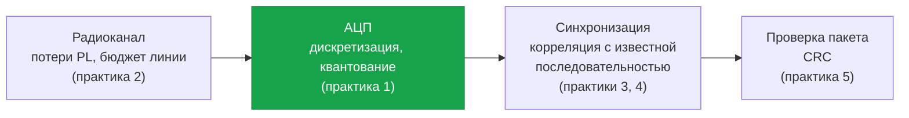
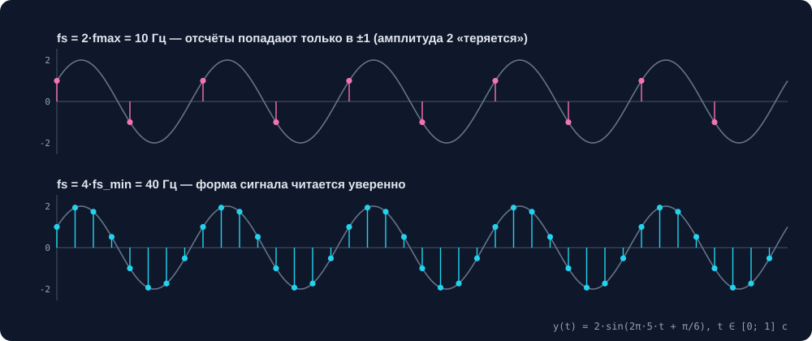
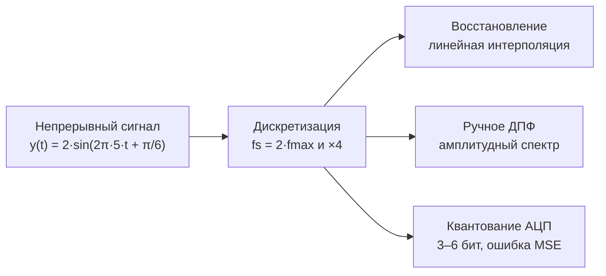
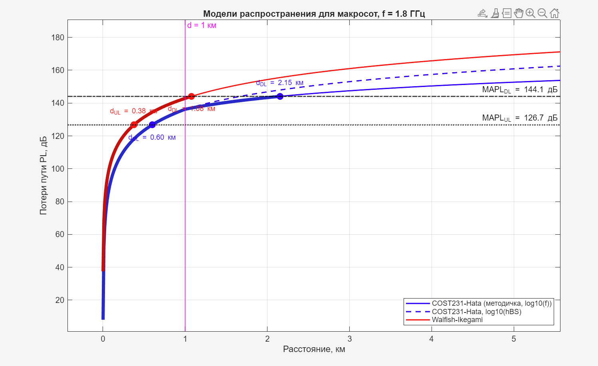
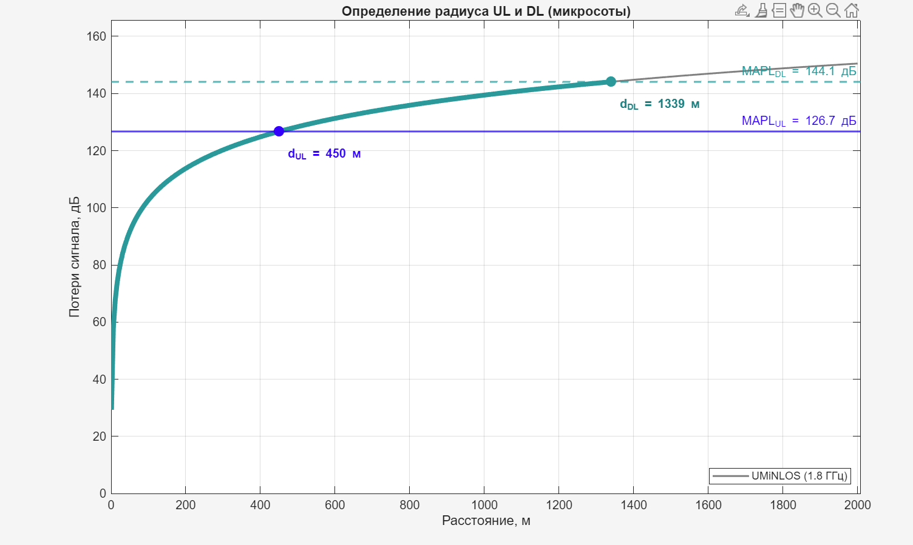
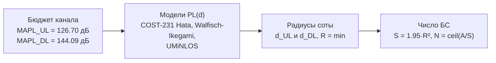

# Основы систем мобильной связи (ОСМС)


Практические работы по курсу «Основы систем мобильной связи» (СибГУТИ, направление 09.03.01).
Цифровая обработка сигналов, расчёт радиопокрытия, корреляционная синхронизация и контроль ошибок CRC.
Языки: MATLAB и C/C++.

**Автор:** Анисимов Тимур Юрьевич · [@dokbrawn](https://github.com/dokbrawn)
**Статус:** практики 1–2 выполнены, остальные — по мере прохождения курса.

## Практические работы

| № | Тема | Инструменты | Папка | Статус |
| :-: | --- | --- | --- | :-: |
| 1 | Временная и частотная формы сигналов, преобразование Фурье, дискретизация | MATLAB | [`practice-1`](practice-1) | выполнена |
| 2 | Проектирование радиопокрытия: модели распространения, бюджеты каналов UL/DL, радиус соты | MATLAB | [`practice-2`](practice-2) | выполнена |
| 3 | Корреляция дискретных сигналов: взаимная и нормализованная корреляция | C/C++, MATLAB | `practice-3` | в планах |
| 4 | Корреляционные свойства PN-последовательностей для синхронизации: коды Голда | C/C++, MATLAB | `practice-4` | в планах |
| 5 | Циклический избыточный код CRC: вычисление и обнаружение ошибок | C/C++ | `practice-5` | в планах |

Как эти темы связаны в приёмнике мобильной сети:



## Практика 1: что сделано

Схема обработки сигнала в работе:





- **Дискретизация и восстановление.** Непрерывный сигнал варианта, дискретизация на минимальной частоте и на частоте ×4, восстановление линейной интерполяцией.
- **Спектр.** Амплитудный спектр аудиофайла по определению ДПФ (через `cos` и `sin`, без `fft`), сравнение с сигналом, прореженным в 20 раз.
- **Квантование.** Округление отсчётов до уровней АЦП при разрядности 3–6 бит, оценка ошибки.
- **Дополнительно.** Синтез мелодии _He's a Pirate_ и её спектр.

| Файл | Что внутри |
| --- | --- |
| [`lab1_part1.m`](practice-1/lab1_part1.m) | дискретизация, восстановление сигнала |
| [`lab1_voice.m`](practice-1/lab1_voice.m) | спектр аудио, прореживание, ручное ДПФ |
| [`lab1_part3.m`](practice-1/lab1_part3.m) | квантование, влияние разрядности АЦП |
| [`lab1_melody.m`](practice-1/lab1_melody.m) | синтез мелодии |

Ручное ДПФ, которое используется в работе:

```
function [Amp, fa] = manual_dft(x, fs)
    N   = length(x);
    k   = (0:floor(N/2))';
    n   = 0:N-1;
    ang = 2*pi*k*n/N;
    R   = cos(ang)*x(:);
    I   = -sin(ang)*x(:);
    Amp = sqrt(R.^2 + I.^2) * 2/N;
    fa  = k*fs/N;
end
```

## Практика 2: что сделано

Схема расчёта радиопокрытия:







- **Бюджет канала.** MAPL для UL и DL из мощностей передатчиков, усилений антенн, выигрыша MIMO, потерь фидера, запасов на проникновение и интерференцию и чувствительностей приёмников.
- **Модели распространения.** COST-231 Hata с двумя вариантами наклона ветви d ≥ 1 км (по lg f из методички и исправленный по lg hBS), Walfisch-Ikegami в записи методических указаний, UMiNLOS для микросот.
- **Радиусы и число БС.** Макросоты на 100 кв.км: Hata — R = 0.598 км и 144 БС, Walfisch-Ikegami — R = 0.375 км и 365 БС. Микросоты на 4 кв.км: UMiNLOS — R = 449.7 м и 11 БС. Радиус везде ограничен восходящим каналом.

| Файл | Что внутри |
| --- | --- |
| [`lab2_1.m`](practice-2/lab2_1.m) | бюджет канала, PL(d) по трём моделям, радиусы d_UL/d_DL, число БС, графики макро- и микросот |

## Как запустить

1. `git clone https://github.com/dokbrawn/OSMS.git`
2. MATLAB: открыть нужный `.m`-файл из папки практики и нажать **Run**.
3. C/C++ (практики 3–5): в папке практики будет инструкция по сборке.
4. Для `lab1_voice.m` положить рядом `voice.wav` (музыкальная запись или речь).

## Контакты

GitHub: [@dokbrawn](https://github.com/dokbrawn)
Email: [tanisimov2006@gmail.com](mailto:tanisimov2006@gmail.com)
